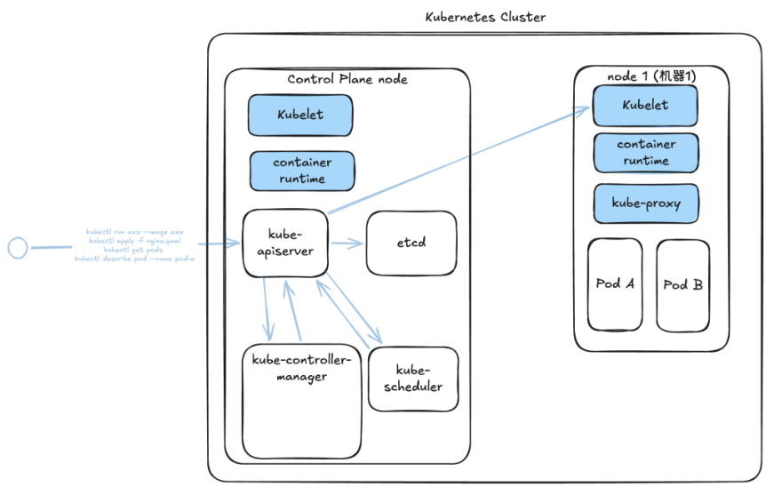
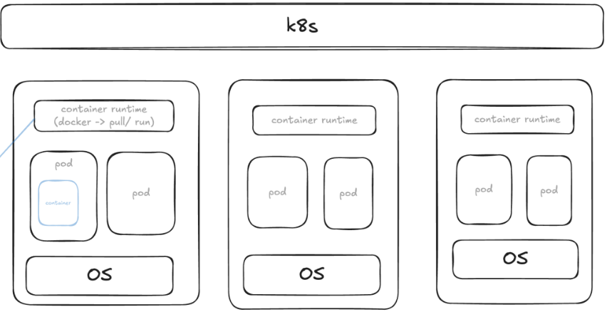
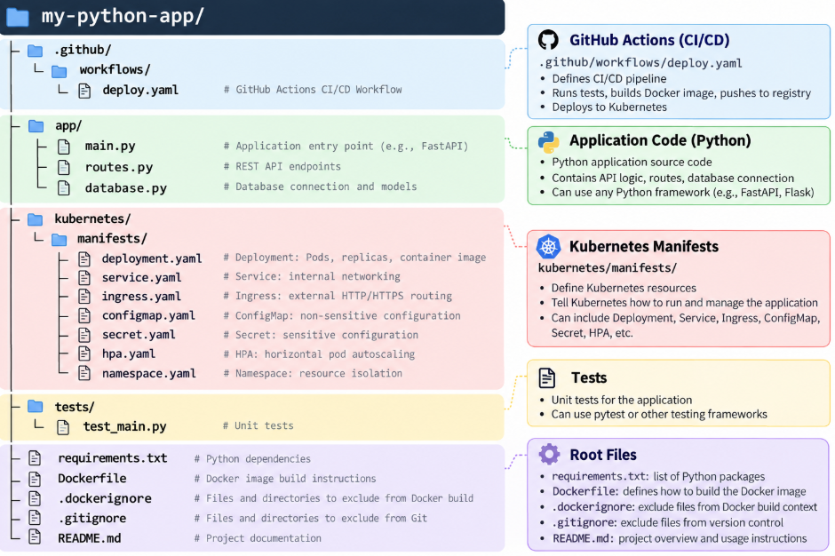
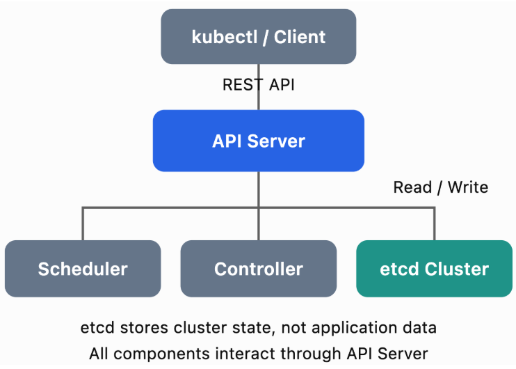
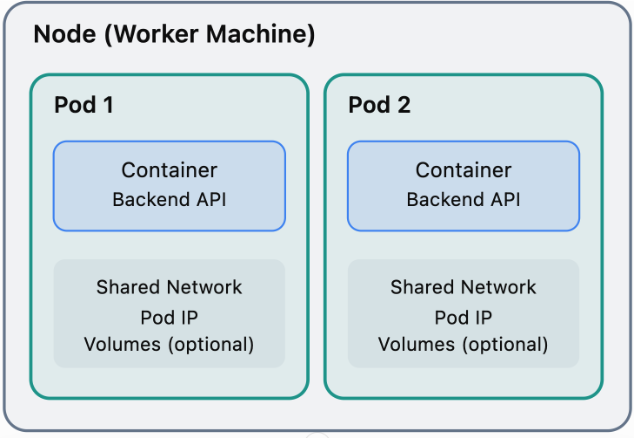
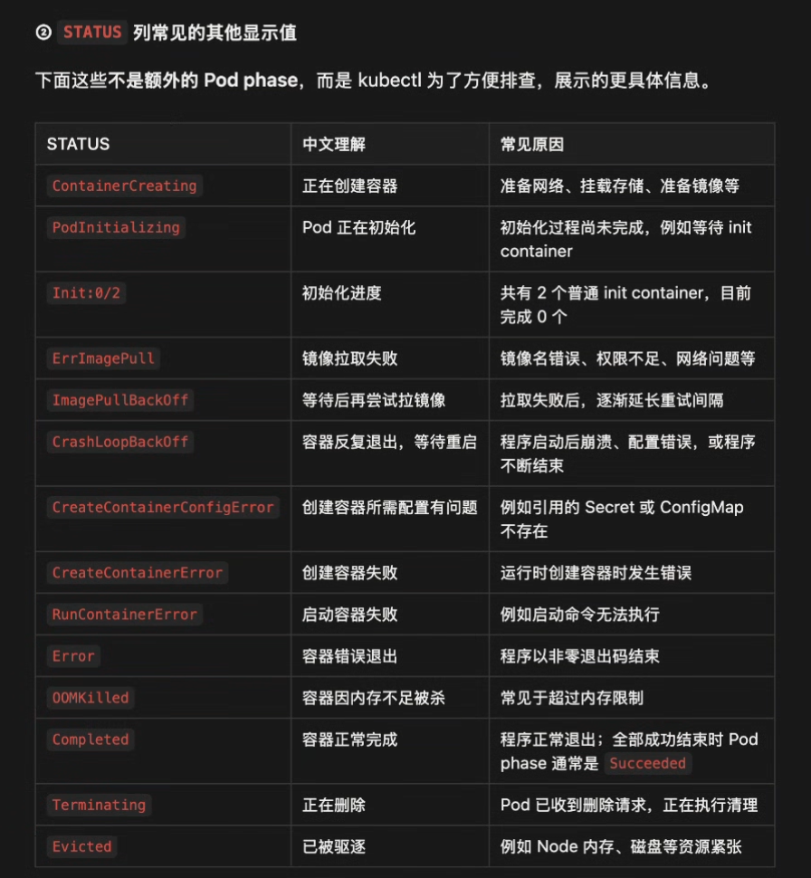
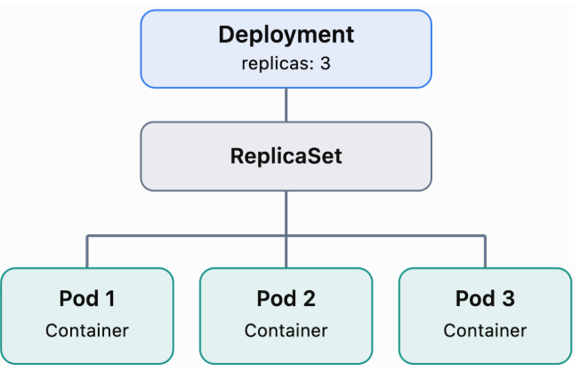
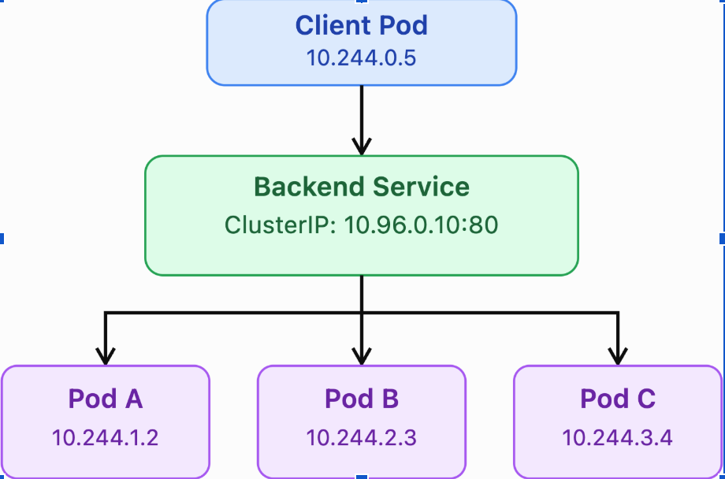

an <mark>open-source container orchestration platform</mark> that automates the deployment, scaling, and management of containerized applications.
### **How does k8s work?**
Kubernetes follows a **control plane and worker node architecture** and uses a **declarative model** to manage containerized applications
* <mark>**Declarative Model**</mark>: Users define the desired state of their applications through **YAML manifests(也可以称作 Declarative Infrastructure Configuration)**, such as the number of replicas, container images, and resource requirements. <mark>Kubernetes continuously reconciles the actual state with the desired state.</mark>

| 对比     | Declarative 声明式                                             | Imperative 命令式                                    |
| ------ | ----------------------------------------------------------- | ------------------------------------------------- |
| 关注点    | 我想要什么状态                                                     | 现在执行什么操作                                          |
| 表达方式   | 声明目标配置                                                      | 发出具体命令                                            |
| K8s 例子 | YAML 中写 `replicas: 3`，执行 `kubectl apply -f deployment.yaml` | 执行 `kubectl scale deployment my-app --replicas=3` |
| 配置管理   | 配置保存在文件中，方便版本控制、审查和重复部署                                     | 直接修改资源，需要额外记录操作才能追踪变化                             |
| 后续维护   | 控制器持续维持期望状态                                                 | 控制器同样持续维持修改后的期望状态                                 |

* <mark>**Control Plane**</mark>: manages the cluster   
  * API Server, ETCD, Controller Manager,Scheduler ,Kubelet, Container Runtime(execute process for other components in control plane)
* <mark>**Worker Nodes**</mark>: run the actual application workloads.  
  * Pods,  kube-proxy, Kubelet, Container Runtime(run the application codes)



  
It also provides important features like **automatic scheduling**, **self-healing and scaling**, **service discovery**, **load balancing**, and **rolling updates**.
* **Self-Healing and Scaling:** Kubernetes continuously monitors the cluster. If a Pod fails, Kubernetes can automatically replace it. If the desired replica count changes, Kubernetes creates or removes Pods accordingly.

| 对比     | Service Discovery 服务发现      | Health Check 健康检查             |
| ------ | --------------------------- | ----------------------------- |
| 核心问题   | 服务在哪里，如何访问？                 | 应用是否正常，能否接收请求？                |
| K8s 实现 | Service 和集群 DNS             | Readiness、Liveness、Startup 探针 |
| 例子     | 通过 `backend` 这个服务名访问后端      | 请求 `/health`，判断应用是否正常         |
| 作用     | 提供稳定的服务名和访问入口，隐藏 Pod IP 的变化 | 根据检查结果控制流量接入或重启容器             |
### **How to deploy your application to k8s?**

1. **Write Application Code**   
   - `requirements.txt` 定义 Python application 需要哪些 dependencies，以及它们的版本， pip install \-r requirements.txt



2. **Create Dockerfile**  
   - `Dockerfile` 是一个用来定义如何把 application code、dependencies 和运行环境打包成 Docker Image 的配置文件

| Instruction keyword | 作用                                          |
| ------------------- | ------------------------------------------- |
| `FROM`              | 指定基础镜像，并开始一个构建阶段。                           |
| `WORKDIR`           | 设置后续指令的工作目录；不存在时自动创建。                       |
| `COPY`              | 将文件或目录复制到镜像，也可通过 `--from` 从其他构建阶段复制。        |
| `ADD`               | 复制文件，额外支持自动解包本地 tar 归档及获取远程内容。              |
| `RUN`               | 构建镜像时执行命令，例如安装依赖。                           |
| `CMD`               | 设置容器启动时的默认命令或参数，可在运行时覆盖。                    |
| `ENTRYPOINT`        | 设置容器启动时执行的主程序，常搭配 `CMD` 提供默认参数。             |
| `ENV`               | 设置环境变量，在后续构建步骤及容器运行时可用。                     |
| `ARG`               | 定义构建时变量，可通过 `--build-arg` 传入，不会自动成为运行时环境变量。 |
| `EXPOSE`            | 声明应用监听的端口；不会自动发布到宿主机，通常还需使用 `-p`。           |
| `VOLUME`            | 声明数据卷挂载点，用于保存指定路径的数据。                       |
| `USER`              | 指定后续构建命令及容器启动命令使用的用户。                       |
| `LABEL`             | 添加镜像元数据，例如版本、描述和维护者信息。                      |
| `HEALTHCHECK`       | 设置容器运行时的健康检查命令。                             |
| `SHELL`             | 指定 shell 形式指令使用的默认 shell。                   |
| `STOPSIGNAL`        | 指定停止容器时发送给主进程的信号。                           |
| `ONBUILD`           | 注册触发指令，在其他镜像以当前镜像为基础构建时执行。                  |

3. **Push Image to Container Registry**, 例如 Amazon ECR  
   - `Docker Image`：打包好的应用运行模板，<mark>Container Registry：存储和管理 Container Images</mark>
   - `docker build -t <image-name>:<tag> <build-context>`  
   - `docker push \<registry\>/\<image-name\>:\<tag\>`  
   - `docker pull \<registry\>/\<image-name\>:\<tag\>
   - 生产环境中,由`CI/CD(GitHub Actions / Jenkins Runner)`自动触发，通常定义在.github/workflows文件目录下的yaml file里
4. **Write Kubernetes Manifests (yaml files)**  
   - deployment.yaml, hpa.yml, service.yaml, ingress.yaml, namespace.yaml等  
5. **Deploy to Kubernetes**   
   - `kubectl create \-f \<manifest-file-or-directory\>`  第一次创建时使用
   - `kubectl apply \-f \<manifest-file-or-directory\>`  
   - 生产环境中，是通过 `CI/CD(GitHub Actions / Jenkins Runner)`自动化部署  
3. **Kubernetes 根据 Deployment 创建 Pods and schedule Pods to Nodes**  
4. **Worker Node 上的 container runtime 从Container Registry上pull Image, create containers and run containers**  
   - `Docker Container`：基于 Docker Image 创建并运行的实例  
   - Kubelet 通过 CRI 调用container runtime，让它在 Worker Node 上创建和运行容器
   - `docker run \-p \<host-port\>:\<container-port\> \<registry\>/\<image-name\>:\<tag\>`

## **Control Plane(Master Nodes)**:

### **API Server**

<mark>entry point for all cluster operations</mark>. It validates requests and persists cluster state in etcd.
* it exposes <mark>the Kubernetes API</mark> which is used by external users to perform management operations on the cluster  
  * authenticate User, validate request, retrieve data, update ETCD, scheduler, Kubelet  
* **kubectl** command can call the kubernetes api



### **ETCD (/etc \+ distributed)**
<mark>A distributed key-value store</mark> that stores the cluster's configuration and state, not application data
* etc: editable text configuration
* all commands starts with `kubectl get` is from etcd server

#### **Desired /Actual state 在etcd以什么形式存储?**

- **key**：`/{Kubernetes etcd Prefix}/{resource-type}/{namespace}/{resource-name}`  
	- 比如：`/registry/deployments/production/nginx-deployment`  
- **value** ： serialized protobuf  (JSON -> binary bytes 通过.proto文件定义数据结构)
	- Kubernetes API Server 会把 YAML 中的 Configuration(通常spec里的data)转换成 Go Struct（Kubernetes API Object），然后使用 Protobuf 将 Go Struct 序列化成 Binary Bytes，最后存储到 etcd  
### **Controller-Manager**: 

<mark>continuously monitor cluster state</mark> through the API Server and take actions to <mark>reconcile **actual state** with **desired state**</mark>.

#### **Controller种类**
- **Node-controller**: 
	- node上的Kubelet 主动发送 Heartbeat 给api server  
	  *  api server 接收更新，并将状态持久化到 etcd  
	  * node controller every 5 seconds 评估Watch/Informer Cache 的 Node Status 和 Lease(Kubernetes 用来记录节点心跳的轻量级对象,跟renewTime一起用) (Node Monitor Period \= 5s)  
		  * `kubectl get lease worker-1 -n kube-node-lease -o yaml`

| 控制器检查时间      | Lease 的 `renewTime` | 距控制器上次观察到心跳进展 | 判断                           |
| ------------ | ------------------- | ------------- | ---------------------------- |
| 10:00:26     | 10:00:20            | 5 秒           | 正常                           |
| 10:00:46     | 10:00:20            | 25 秒          | 没有新心跳，仍在宽限期内                 |
| 10:01:06     | 10:00:20            | 45 秒          | 仍在宽限期内                       |
| **10:01:11** | 10:00:20            | **恰好 50 秒**   | 尚未超过宽限期                      |
| **10:01:16** | 10:00:20            | **55 秒**      | 超过宽限期，将 `Ready` 设为 `Unknown` |
	  * if no heartbeat for 50s(Node Ready \= Unknown), the node is marked unreachable (Node monitor Grace Period \= 50s)  
	  * after a node is marked unreachable, 添加 NoExecute Taint到node上  

| Effect             | 作用                            |
| ------------------ | ----------------------------- |
| `NoSchedule`       | 阻止不容忍它的新 Pod 调度进来，已有 Pod 不受影响 |
| `PreferNoSchedule` | 尽量避免调度不容忍它的新 Pod              |
| `NoExecute`        | 阻止不容忍它的新 Pod，并驱逐不容忍它的已有 Pod   |

	  * it gives it 5mins to come back up  
	  * if the node doesn’t come back, it removes the pods assigned (taint-based eviction) and provisions them on the healthy ones from replica sets  
- **Replication-controller**
	- monitor the status of replica sets and ensure the desired number of pods are available at all times within the set 
	- if a pod dies, it creates another one  
* **Deployment-controller**  
	* 通过创建和管理 ReplicaSet，让应用的副本数和版本符合 Deployment 声明的期望状态，并实现rolling update与roll back。
* **Namespace-controller** 
	* Namespace（命名空间）是一种用于对集群资源进行逻辑分组和隔离的机制, 可以理解成 Kubernetes 集群中的一个虚拟文件夹或者一个逻辑容器，用来组织一组相关的 Kubernetes 资源。
	* 比如，假设你有一个电商应用（E-commerce Application），它包含三个微服务：User Service， Order Service， Payment Service，每个 Service 都运行多个 Pod。 这时可以创建一个namespace用来组织整个电商应用的生产环境资源。  
	* 实际生产中，通常不同stage是不同namespace  
	    * Namespace: development  
	    * Namespace: staging  
	    * Namespace: production  
	- **Note:** Namespace 是逻辑分组，Node 是实际运行 Pod 的机器. 一个 Namespace 可以包含运行在多个 Node 上的 Pod, 一个 Node 可以运行来自多个 Namespace 的 Pod  
* **Endpoint-controller**  
* **Job-controller**  
* **Service-Account-controller**  
* **PV-Protection-controller**  
* **PV-Binder-controller**

**Install kube-controller-manager:**
`wget https://storage.googleapis.com/kubernetesrelease/v1.xx.0/bin/linux/amd64/
`kube-apiserver`

**View kube-controller-manager:**
`kubectl get pods -n kube-system`
get看状态，describe看具体内容

**View kube-controller-manager options**
`cat /etc/kubernetes/manifests/kube-controller-manager.yaml`
`cat /etc/kubernetes/manifests/kube-controller-manager.service`
`ps \-aux | grep kube-controller-manager`

### **Scheduler** 

Watches for unscheduled Pods and assigns them to suitable worker nodes based on resource availability and scheduling constraints. <mark>唯一的作用！<mark>
* the scheduler continuously monitor the API server for any pod update event  
* the scheduler looks at each pod and tries to find the best node for it (Filter → Score → Select Node) 
#### **Kubernetes如何schedule pod to a node?**
<mark>Kubernetes 使用 **List/Watch \+ Event-driven mechanism** 来触发 Scheduling</mark>
* **Trigger 1: Scheduler Startup(List)**
	* Scheduler 启动后，Informer 执行 **Initial LIST**  
	    * Pod Informer 向 API Server 请求: GET /api/v1/pods  
	    * Node Informer 向 API Server 请求: GET /api/v1/nodes  
	  * Informer 用它们初始化 Local Cache  
* **Trigger 2: New Pod Creation (Watch)**  
	* **Step 1 — New Pod Creation**  
	    * ReplicaSet Controller sends `POST /api/v1/namespaces/default/pods` to API Server  
	    * API Server validates and persists the Pod Object in etcd  
	    * Initially, `spec.nodeName` is empty  
	* **Step 2 — API Server Watches etcd (gRPC Streaming)**  
	    * API Server 作为 gRPC Client，调用 etcd Watch API，establishes a gRPC Stream with etcd  
	    * When the Pod Object is created, etcd delivers a `PUT` Event over the existing stream.  
	    * etcd v3 的 Watch 数据变更事件只有两种：

| Event Type | 含义             | 例子                   |
| ---------- | -------------- | -------------------- |
| `PUT`      | 创建或更新一个 key 的值 | 创建 Pod、更新 Pod Status |
| `DELETE`   | 删除一个 key       | Pod 对象最终从存储中删除       |
	* **Step 3 — Scheduler Watches API Server (HTTP Streaming)**  
	    * Scheduler 调用 Kubernetes Watch API , 与 api server建立长期的http streaming  
	    * API Server delivers a Pod `ADDED` Event over the existing HTTP Stream

* **After trigger: Scheduling Queue → Scheduling Cycle** 
	* **Step 1 — Informer** updates its **local cache** and invokes the registered **Event Handler.**  
	    * Informer Cache \= Kubernetes API Objects 的本地数据存储层, 可以用来initial list,reconnect watch…etc  
	    * Scheduler Cache \= Scheduling 专用的状态层  
	* **Step 2 — Event-driven Scheduling Trigger**  
		* **Event Handler** identifies an unscheduled Pod and adds it to the **Scheduling Queue**, and update the **Scheduler Cache** and **Scheduler snapshot**  
		    * schedulerCache.UpdateSnapshot(snapshot)  
		* The scheduler picks the Pod from the queue.  
		* Scheduler executes **Filter → Score → Select Node**.  
		* Scheduler sends a **Binding request** to API Server.
       ==**Note: Scheduler 既是 Producer，也是 Consumer, 不同组件扮演不同角色**

	* **Step 3 — Kubelet Starts Containers**
		* API Server persists the Pod's assigned `spec.nodeName` in etcd.  
		* Kubelet on the selected Node discovers the assigned Pod through its API Server watch. 
		* Kubelet instructs the Container Runtime to pull the image and start containers.


**install scheduler**
`wget https://storage.googleapis.com/kubernetes-release/release/v1.xx.0/bin/linux/arm64/kube-scheduler`

**view kube-scheduler options**
`cat /etc/kubernetes/manifests/kube-scheduler.yamlps \-aux | grep kube-scheduler`

## **Worker Nodes**

<mark>一个node里可以运行一个或多个pods，一个 Pod 可以包含一个或多个 Container，而 Container 是根据 Container Image 创建的. 一个Container Image通常是由一个Microservice Application构建</mark>
* **Container**：真正运行 Application Code 的地方  
* **Pod**：包含一个或多个 Containers，为它们提供共享的网络和存储环境  
* **Node**：实际运行 Pod 的机器，可以是 Virtual Machine 或 Physical Machine



### **Pods**

Kubernetes does not deploy containers directly on the worker nodes. The containers are encapsulated into a Kubernetes object known as pods. A pod is a single instance of an application. <mark>A pod is the smallest object that you can create in Kubernetes.</mark>

Pods usually have a 1to1 relationship with containers running your application. 1 pod can have multiple containers, but they usually don’t. To scale up, you create new pods, to scale down you delete existing pods. You do not add additional containers to existing pods to scale your system.

#### **Why do we need Pods?**

Pod 解决的是Container 如何被组织成一个可调度、可管理的应用运行单元（Deployment and Scheduling Unit).
- 假如没有Pod，Kubernetes 直接管理 Containers， Container 为最小调度单元，Container A 被调度到 Node 1， Container B 被调度到 Node 2， Container C 被调度到 Node 3，这三个 Containers 本来需要紧密协作，现在却分布在不同机器上。
- 即使只有一个 Container，Pod 仍然为 Kubernetes 提供了统一的抽象，让 Kubernetes 不需要为单 Container 和多 Container 设计两套完全不同的调度与管理机制。

Pod可以提供：
* Co-location & Scheduling  
* Shared Network Environment  
* Shared Storage  
* mount volume(挂载存储卷), 将一块存储空间（Volume）连接到 Container 内部的某个文件系统路径（Mount Path），使 Container 可以像访问本地文件或目录一样读取和写入数据  
    * Volume：一块可供 Container 使用的存储空间  
    * Mount：将这块存储空间映射到 Container 的文件系统中  
    * Mount Path：Container 内访问这块存储空间的路径，例如 `/app/data`  

| 概念                       | 关注的问题      | 含义                    |
| ------------------------ | ---------- | --------------------- |
| **Mount volume（挂载卷）**    | 容器如何访问存储？  | 把卷映射到容器内的某个路径         |
| **Shared storage（共享存储）** | 谁能访问同一份存储？ | 多个容器、Pod 或节点可以访问同一份数据 |
* Unified Lifecycle Management

#### **创建pod的流程**

* client发送pod 创建请求 (kubectl apply \-f pod.yaml)  
* API Server 接收请求，验证并将 Pod Object 持久化到 etcd。  
* Scheduler 通过 API Server 的 Watch 机制发现没有分配 Node 的 Pod，选择合适的 Node，并完成 Binding。(scheduler的主要任务,没有controller的介入)  
* Kubelet watch到分配给自己 Node 的 Pod，开始处理 PodSpec。  
* Container Runtime（例如 containerd）通过 CRI 与 Kubelet 配合，创建 Pod Sandbox 并启动 Containers。  
* CNI(container network interface) Plugin 配置 Pod Networking，包括 Network Namespace、Pod IP、Network Interfaces 等。  
* Kubelet 持续监控 Container 状态，并向 API Server 汇报 Pod Status。

```python
# create a pod and deploy an instance of the nginx docker image, you can configure Kubernetes to pull the image from the public Docker hub or a private repository
kubectl run nginx \- \- image nginx

'''
apiVersion: v1  
kind: Pod  
metadata:  
    name: myapp-pod  
    labels:  
        app: myapp  
        type: front-end  
spec:  
    containers:  
      - name: nginx-container  
        image: nginx  
''' 
# Once the yaml file is created ,run the following command  
kubectl create -f pod-definition.yaml #第一次创建

# Or
kubectl apply -f pod-definition.yaml

# 将创建pod with image进行dry-run，将这个过程的configuration生成yaml file保存起来
kubectl run <pod-name> --image=<image-name> --dry-run=client -o yaml > <file-name>.yaml

# view a list of pods in the k8s cluster
kubectl get pods     # 查看当前namespace下的pods 
kubectl get pods \-A # 查看所有namespace下的pods 
kubectl get pod nginx \-o jsonpath='{.status.phase}' # 查看Pod 正式的 phase
kubectl describe pod myapp-pod
```

#### **Pods with YAML**
Kubernetes uses YAML files as inputs for the creation of objects such as pods, replicas, deployments, services,etc. All of them have similar structure with 4 root level properties(required fields):

* **apiVersion**  
	* the version of Kubernetes API we are using to create the object  
	* Pod → v1, Service → v1, ReplicaSet → apps/v1, Deployment → apps/v1  
	* `kubectl api-resources` 可以查询version
* **kind**  
	* the type of object we are creating , like Pod,Service, ReplicaSet, Deployment 
* **metadata**  
	* the data about the object like name, labels, etc  
* **spec**  
	* additional information to Kubernetes pertaining to that object  
	* the format is different for different object, you can refer to the k8s document to get the correct one
#### **Pods Lifecycle**
5个正式阶段
* Pending 等待中—- Pod 已被接受，但 Containers 尚未全部准备好  
* Running 运行中—- Pod 已绑定 Node，至少一个 Container 正在运行、启动或重启  
* Succeeded —- 所有 Containers 成功终止  
* Failed —- 所有 Containers 已终止，至少一个失败  
* Unknown —- Kubernetes 无法确定 Pod 状态



#### **如果 Pod 崩溃怎么办？**

如果 Container Crash，Kubelet 通常可以在同一个 Pod 中重启 Container（默认 `restartPolicy: Always`）。但是，如果整个 Pod 被删除，或者原 Node 故障导致这个 Pod 丢失，一个直接创建的独立 Pod 不会自动由 Kubernetes 在其他 Node 上重新创建。  
这就是为什么 Production 通常使用 **Deployment** object. Deployment 会通过 ReplicaSet 维持三个 Pod Replicas



如果 Pod 2 消失：
1. ReplicaSet Controller 发现实际只有两个 Pods。  
2. Desired Replicas 仍然是 3。  
3. ReplicaSet 创建一个 Replacement Pod。  
4. Scheduler 为新 Pod 选择 Node。  
5. Kubelet 启动新 Pod 的 Containers。

需要特别注意：新建的是一个新的 Pod，通常会有新的 Pod Name、UID 和 Pod IP。
### **Container Runtime**
runs the containers, typically using containerd or CRI-O
### **Kubelet**

Listen to instructions from the Kube API server and deploy or destroy containers on the nodes  
每个 Worker Node 上的核心 Agent，负责管理该 Node 上的 Pods 和 Containers，确保它们按照 Kubernetes 声明的 Desired State 运行

#### **Kubelet 如何manage container?**
* <mark>**Flow1: Control Plane → Kubelet**</mark> 
	* Kubelet 通过 Watch API Server 获取 Pod 的 Desired State。  
* <mark>**Flow2: Kubelet → Container Runtime**</mark>  
	* Kubelet 比较 Desired State 和 Actual State，通过 CRI 调用 Container Runtime，让它创建、启动、停止或删除 Container  
* <mark>**具体步骤如下**</mark>：  
	* **Step 1 — Scheduler Assigns Pod to Node**  
		* Scheduler 通过 API Server 的 Binding API 将 Pod 绑定到 `worker-1`  
	    * API Server 将pod assignment status 存入etcd中  
	* **Step 2 — Kubelet Watches API Server (HTTP Streaming)**  
	    * 当 Pod 被分配给 `worker-1` 时，API Server 通过 HTTP Watch Stream 将变化通知 Kubelet。  
    * **Step 3 — Kubelet Updates Pod State**  
	    * Desired State来自于用户/manifest yaml，存在etcd里，kubelet通过list/watch获取，存入pod manager并管理  
	    * etcd里也存actual state，但不是实时的用于kubelet reconciliation的actual state，而是kubelet上报的PodStatus  
	    * Actual State来自于container runtime，可通过CRI 获取，或者是PLEG(Pod Lifecycle Event Generator)存储的local cache里获取  
    * **Step 4 — Kubelet Reconciliation**  
	    * 以下event 触发了reconciliation ：
		    * API Server Watch event (Pod Added / Updated / Deleted)  
		    * PLEG event (Container Lifecycle Event）  
			    * PLEG检测pod和container的lifecycle change，并生成event, 同时也会把检测到的actual state存到cache里  
		    * Kubelet event (Periodic Resync)  
		    * Kubelet event (Runtime / Probe-related Events)   
			    * Kubelet 的 Probe Manager 确实会周期性地检测 Container 的健康状态  
				    * Probe Manager：管理所有 Container 的 Probe Workers  
				    * Probe Worker：按照 `periodSeconds` 周期执行具体的健康检查(Startup Worker, Readiness Worker, Liveness Worker)  
					    * Startup Probe：检查容器中的应用是否已经成功启动  
					    * Readiness Probe：检查容器是否准备好接收流量  
					    * Liveness Probe：检查容器是否仍然正常运行，是否需要重启  
				    * Prober：实际执行 HTTP、TCP、Exec 或 gRPC 健康检查的最小单位  
					    * HTTP GET:  Kubelet 向 Pod IP 的 HTTP Endpoint 发请求  
					    * TCP Socket: Kubelet 尝试建立 TCP Connection  
					    * gRPC: Kubelet 调用应用的 gRPC Health Checking API  
					    * Exec: Kubelet 通过 CRI 在 Container 内execute commands  
		* Kubelet使用多个 Event Channels / Update Sources 接收不同类型的events，再由 `syncLoop` 统一监听和分发，最终交给 `podWorkers`   
		* Kubelet的Pod Workers执行 `SyncPod`，结合desired state和actual state来决定是否需要 Create、Start、Stop 或 Restart Containers  
	* **Step 5 — Kubelet Calls Container Runtime via CRI gRPC**  
		* RunPodSandbox()   
	    * PullImage()   
	    * CreateContainer()  
	    * StartContainer()   
	* **Step 6 — Container Runtime Starts the Process**

**install kubelet (kubeadmin tool安装不了kubelet）**
`wget https://storage.googleapis.com/kubernetes-release/release/v1.xx.0/bin/linux/
`arm64/kubelet`

**view kubelet options**
`ps \-aux | grep kubelet`

### **Kube-Proxy**

is a Kubernetes networking component responsible for implementing <mark>Service routing and load balancing</mark>.Implements Service networking rules to route traffic to appropriate Pod endpoints (in clusters that use kube-proxy)
#### **Why Do We Need kube-proxy?**  
Pod 有自己的 IP，同一个 Pod 内的 Containers 共享同一个 Pod IP 和网络命名空间，因此同一个Pod里的container间通常可以通过 `localhost` 加`port`进行通信。

不同 Pod 则通常有不同的 Pod IP, 它们能够通过各自的 IP 通信，具体由 CNI 配置的网络实现。但是 Pod IP addresses are dynamic，假如Pod B崩了,Kubernetes 重新创建一个 Pod,IP就不再是原来的了,Pod A 如果继续访问旧 IP，就会失败。所以we need a stable way let pods to communicate with each other, regardless of which Pods are running or where they are located.



#### **Kubernetes如何解决不同pods间的访问问题**
<mark>Kubernetes 通过**service和kube-proxy**来解决这个问题，让pod能被稳定地访问。</mark>
* Service 就是一个Kubernetes API Object，Service Name通过CoreDNS被解析为**ClusterIP(虚拟 IP）**它为一组动态变化的 Pods 提供稳定的访问入口  
	* 有三种service: **NodePort, ClusterIP, Loadbalancer, Headless**  
	* **Flow 1 — 创建 Service**  
		* `kubectl apply \-f backend-service.yaml` → API Server → API Server 的 Service IP 分配机制从配置的 Service CIDR(Classless Inter-Domain Routing) 中 Allocate ClusterIP (10.96.0.20) → Persist Service Object into etcd  
			* **CIDR 用来表示一个 IP 地址范围，方便分配网络地址和制定网络规则**， 比如`192.168.1.0/24` , 表示 `192.168.1.0～192.168.1.255` 这一段地址。`/24` 表示前 24 位固定
	* **Flow 2 — CoreDNS 获取 Service 信息**  
	    * CoreDNS 是 Kubernetes 中常用的 DNS Server， 和互联网 DNS 的原理类似, **是为了建立“服务域名 → ClusterIP”的对应关系，回答 Pod 的 DNS 查询。**
	    * 比如 Service 创建后，CoreDNS 通过 API Server 的 **List / Watch** 获取并持续更新这些信息，在内存中维护 backend-service.default.svc.cluster.local → CoreDNS → 10.96.0.20  
	    * 当另一个 Pod 想访问后端时：
	        * Pod 向 CoreDNS 查询 backend-service.default.svc.cluster.local
	        * CoreDNS 返回 10.96.0.20
	        * Pod 向 10.96.0.20 发起请求
	        * Service 的转发机制将请求送到后端 Pod
* kube-proxy configures networking rules that allow the Linux kernel to translate a Service IP into an actual backend Pod IP. kube-proxy 的任务，就是配置 Node 的网络转发机制，使这个请求能够到达某个 Backend Pod，每个worker node都有一个kube-proxy  
	   * **Flow 1 —   kube-proxy 配置网络规则（Control Plane -> kube-proxy)** 
		   * 用户创建一个 Kubernetes Service, API Server 将 Service Object 持久化到 etcd 
		   * EndpointSlice Controller 根据符合 Service selector 的 Pod，维护 EndpointSlice  object
			   * EndpointSlice contains actual endpoints of backend pods  
			   * Service 通过 `selector` 来决定哪些 Pod 属于这个 Service 的后端  
		   * kube-proxy 通过 Watch API Server 获得 Service 和 EndpointSlice 的变化  
		   * **Based on the Service and EndpointSlice information(desired state), kube-proxy creates or updates forwarding rules (iptables rules) **
	* **Flow 2 — Client 访问 Service（Data Plane）**  
		* 当 Client Pod 发送请求：GET [http\://10.96.0.10:80](http://10.96.0.10:80) , it initiates a TCP connection to **Service (IP is** 10.96.0.10:80 )  
		* Packet enter the client pod's Node's Linux network stack through a veth pair (Virtual Ethernet pair)  
			* Pod 和 Node 共享同一个 Linux Kernel，只是 Pod 的 Network Namespace 提供了隔离的网络环境. 在 Linux 中，每个 Network Namespace 都有自己独立的网络环境, 包括:Network interfaces(网络接口),IP addresses(IP 地址),Routing tables(路由表),Network-related socket state, Firewall rules（防火墙规则）  
		*  Linux network stack里的Netfilter 检查 iptables 规则，发现目标是 Service ClusterIP 
		* Based on **iptables rules**, select Backend Endpoint  
			* iptables 是 Linux 中用于配置网络数据包处理规则的工具。 它可以控制一个 packet 是被允许、丢弃、修改目标地址，还是转发到其他地方. kube-proxy 利用 iptables 实现 Service 的流量转发和负载均衡。  
		* DNAT(Destination Network Address Translation) 将cluster IP 改成backend pod的地址： 10.96.0.10:80 → 10.244.2.6:8080  
		* Linux 根据新的目标地址route packet to Backend Pod B  
			* iptables 可以把 Service ClusterIP 转换为 Pod IP，但真正决定 Packet 如何到达目标 Pod 的，是 IP Routing。 
			* Linux Kernel 根据 Packet 的 Destination IP 查询 **Routing Table**，决定 Packet 应该从哪个 Network Interface 发出去，以及下一跳（Next Hop）是谁  
    * kube-proxy 通过 DaemonSet 部署
        * **DaemonSet** 确保每个符合条件的 Node 上运行一个对应的 Pod；新增符合条件的 Node 时，会自动为它创建 Pod。常用于部署 kube-proxy、日志采集器和网络插件等节点组件。
        * Node 上的组件有的以 Pod 运行，有的直接作为宿主机进程运行, kube-proxy 通常是pod
```python
# Service objects,这里并没有展示出所有信息

apiVersion: v1
kind: Service
metadata:
  name: backend-service  # Service 的名称
  namespace: default
spec:
  type: ClusterIP
  selector:
    app: backend # Service 根据这个选择label标记为“app: backend”的pod
  ports:
    - port: 80
      targetPort: 8080

# EndpointSlice objects, 记录service和pods的匹配结果
apiVersion: discovery.k8s.io/v1
kind: EndpointSlice
metadata:
  name: backend-service-abc12
  namespace: default
  labels:
    kubernetes.io/service-name: backend-service # 表示这个 EndpointSlice 属于哪个 Service
    endpointslice.kubernetes.io/managed-by: endpointslice-controller.k8s.io
ports:
  - name: ""
    protocol: TCP
    port: 8080
endpoints:
  - addresses:
      - "10.244.1.5"
    conditions:
      ready: true
    targetRef:
      kind: Pod
      namespace: default # 不是network namespace，是Kubernetes 中对资源进行逻辑分组的机制
      name: pod-a
  - addresses:
      - "10.244.2.5"
    conditions:
      ready: true
    targetRef:
      kind: Pod
      namespace: default
      name: pod-b
  - addresses:
      - "10.244.3.5"
    conditions:
      ready: false
    targetRef:
      kind: Pod
      namespace: default
      name: pod-c
```

```python
# Routing Table shows how to route to an destination IP

10.244.1.0/24 dev cni0  
10.244.2.0/24 via 192.168.1.20 dev eth0 
# 10.244.2.0/24：目标Pod B IP 所在的网络
# via 192.168.1.20：下一跳是 Node B
# dev eth0：通过 Node A 的 eth0 网络接口发送

  
192.168.1.0/24 dev eth0  
default via 192.168.1.1 dev eth0
```

```python
# 下图展示了iptables的组织方式
Table: nat
│
├── Chain: PREROUTING
│   └── Rule: Jump to KUBE-SERVICES
│
├── Chain: KUBE-SERVICES
│   └── Rule: Destination 10.96.0.10:80 → Jump to KUBE-SVC-BACKEND
│
├── Chain: KUBE-SVC-BACKEND
│   ├── Rule: 50% probability → Jump to KUBE-SEP-A
│   └── Rule: Otherwise → Jump to KUBE-SEP-B
│
├── Chain: KUBE-SEP-A
│   └── Rule: DNAT → 10.244.1.5:8080
│
└── Chain: KUBE-SEP-B
    └── Rule: DNAT → 10.244.2.5:8080
    
# 实际规则文本是：
-A KUBE-SERVICES -d 10.96.0.10/32 -p tcp --dport 80 -j KUBE-SVC-BACKEND

-A KUBE-SVC-BACKEND -m statistic --mode random --probability 0.5 -j KUBE-SEP-A
-A KUBE-SVC-BACKEND -j KUBE-SEP-B

-A KUBE-SEP-A -p tcp -j DNAT --to-destination 10.244.1.5:8080
-A KUBE-SEP-B -p tcp -j DNAT --to-destination 10.244.2.5:8080

#表达的关系是：
KUBE-SERVICES
    ↓ 匹配 Service IP:port
KUBE-SVC-xxx
    ↓ 选择一个后端
KUBE-SEP-xxx
    ↓ DNAT
Pod IP:port
```
**install kube-proxy**
`wget https://storage.googleapis.com/kubernetes-release/release/v1.xx.0/bin/linux/
`arm64/kube-proxy`

**view kube-proxy options**
`ps -aux | grep kube-proxy`
``
